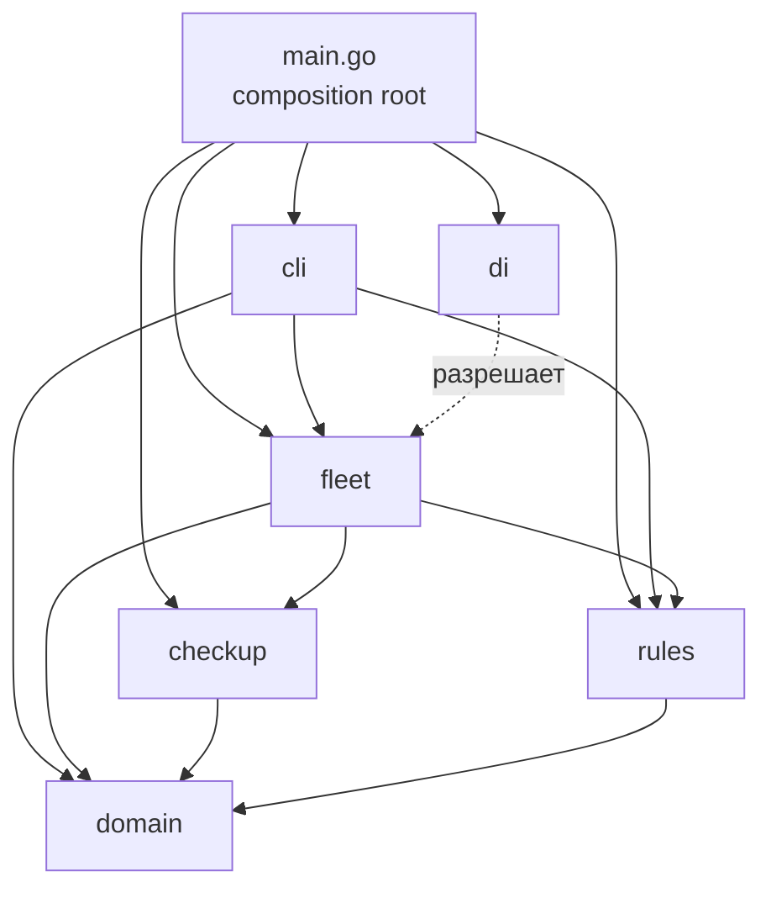

# whooshcat — учёт парка кикшеринга

Консольное приложение для учёта парка. Демонстрирует
доменную модель, принципы SOLID, DI-контейнер и юнит-тесты на Go.

## О проекте

Приложение позволяет:

- принимать технику в парк с прохождением техосмотра (принять / отклонить);
- ставить на баланс вещи: шлемы, зарядные станции, док-станции;
- видеть суммарное суточное потребление энергии парка;
- получать список техники, подходящей новичкам;
- выводить наименования и инвентарные номера всей техники и вещей.

Модель предметной области:

- `InventoryNumber` — value object инвентарного номера;
- `Inventoriable` — всё, что имеет номер и имя (техника и вещи);
- `EnergyConsumer` — всё, что потребляет энергию (электротранспорт и зарядные станции);
- `Transport` — транспорт (самокат, велосипед, электровелосипед);
- `ElectricTransport` — транспорт, который ещё и потребляет энергию;
- `Helmet`, `DockStation`, `ChargingStation` — вещи на балансе.

## Запуск

Требуется Go 1.21+.

```bash
go run .
```

Сборка и тесты:

```bash
go build ./...
go test ./...
go test -cover ./...
```

Форматирование и статический анализ:

```bash
gofmt -l .
go vet ./...
```

В консоли доступно меню:

1. Принять технику (с техосмотром)
2. Добавить вещь на баланс
3. Отчёт: количество и суммарная энергия
4. Список техники для новичков
5. Показать всё с инвентарными номерами
6. Выход

## Архитектура

Проект разделён на пакеты по зонам ответственности:

```text
whooshcat/
├── main.go           composition root: собирает зависимости через DI
├── domain/           модель предметной области
├── checkup/          сервис техосмотра
├── rules/            правила (политика для новичков)
├── fleet/            агрегат парка: приём, хранение, отчёты
├── di/               DI-контейнер
└── cli/              консольный интерфейс
```

Зависимости направлены в одну сторону:

```text
cli → fleet → checkup, rules → domain
main → di → все пакеты
domain → только стандартная библиотека
```

Пакет `domain` не импортирует ничего из проекта — это самая стабильная часть
программы. Все остальные пакеты зависят от него, но не наоборот.

- **domain** — модель предметной области. Не знает ни про консоль, ни про DI,
  ни про техосмотр. Меняется только при изменении бизнес-правил.
- **checkup** — отдельный модуль техосмотра. Его контракт (`Inspector`) и реализация
  (`RealInspector`) живут вместе, но `fleet` зависит только от интерфейса.
- **rules** — правила выдачи новичкам. Отдельный пакет, потому что правило может
  меняться независимо от модели и парка.
- **fleet** — агрегат: хранит всё, что на балансе, и отвечает на вопросы отчётов.
  Не знает, как устроен техосмотр, — только дёргает `Inspector`.
- **cli** — адаптер между пользователем и доменом. Единственный пакет, который
  знает про `fmt`, `bufio` и ввод-вывод.
- **di** — контейнер, который нужен только в `main.go`, чтобы не собирать цепочку
  зависимостей вручную.
- **main.go** — composition root. Никакой логики, только регистрация фабрик и запуск.



## Принципы SOLID

### SRP — Single Responsibility Principle

Наиболее явно применён на уровне пакетов:

- `domain` — только модель;
- `checkup` — только техосмотр;
- `rules` — только правила;
- `fleet` — только агрегат и отчёты;
- `cli` — только интерфейс;
- `di` — только сборка зависимостей.

Внутри пакетов тоже разделение: каждый тип транспорта в своём файле
(`scooter.go`, `bicycle.go`, `ebike.go`), каждая команда CLI в своём файле
(`commands_accept.go`, `commands_add_item.go` и т.д.).

### OCP — Open/Closed Principle

Новый вид транспорта добавляется без правки существующего кода:

- достаточно создать новый тип в `domain`, реализующий `Transport` (и, при
  необходимости, `EnergyConsumer`);
- `fleet` и отчёты не меняются — они работают с интерфейсами;
- меняется только команда приёма техники (`cli/commands_accept.go`), чтобы
  спросить специфичные поля, и `main.go`, если нужно.

Пример: `Bicycle` не потребляет энергию и реализует только `Transport`.
`Scooter` и `EBike` реализуют `ElectricTransport`. `Fleet` не знает разницы —
он раскладывает объекты по коллекциям через type assertion на интерфейсы.

### LSP — Liskov Substitution Principle

`Scooter`, `Bicycle`, `EBike` — все реализуют `Transport`. Любая функция,
принимающая `Transport`, работает с любым из них. `BeginnerFriendly` в `fleet`
не знает, какой конкретно транспорт ей передали, и не должна знать.

### ISP — Interface Segregation Principle

Интерфейсы маленькие и разделены по назначению:

- `Inventoriable` — только `Number()` и `Name()`;
- `EnergyConsumer` — только `DailyEnergyKWh()`;
- `Transport` — `Inventoriable` + `BeginnerSimplicity()`;
- `ElectricTransport` — `Transport` + `EnergyConsumer`.

Шлем не обязан реализовывать `DailyEnergyKWh()` — он не потребитель энергии.
Зарядная станция не обязана реализовывать `BeginnerSimplicity()` — она не транспорт.
Если бы был один «жирный» интерфейс `Asset`, шлему пришлось бы возвращать
бессмысленный ноль, а это нарушение ISP.

### DIP — Dependency Inversion Principle

`fleet.Fleet` зависит от абстракции `checkup.Inspector`, а не от конкретной
реализации `RealInspector`. Это позволяет в тестах подставить `fakeInspector`.

`cli.App` и команды зависят от `*fleet.Fleet` и `rules.BeginnerPolicy`, а не
создают их внутри себя.

`main.go` — единственное место, где выбираются конкретные реализации.

### Сознательное ограничение SOLID

OCP в команде приёма техники ограничен. В `cli/commands_accept.go` ветвление
по типу транспорта сделано через `switch`:

```go
switch kind {
case "scooter":
    ...
case "bicycle":
    ...
case "ebike":
    ...
}
```

Это лёгкое нарушение: при добавлении нового типа придётся править эту
команду. Почему я выбрал простой путь, а не через фабрики:

- типов мало (три), и они стабильны(не планирует введение новой техники);
- альтернатива — реестр с фабриками — для трёх типов была бы
  оверинжинирингом;

Если типов станет больше пяти или они начнут
добавляться часто, `switch` стоит заменить на реестр.

## DI-контейнер

`di.Container` — реестр фабрик с инициализацией и кешированием:

- `Register(name, factory)` — зарегистрировать фабрику;
- `Resolve(name)` — получить объект (создаётся при первом запросе, дальше
  возвращается из кеша);
- `MustResolve(name)` — то же, но паникует при ошибке (удобно в `main.go`).

Контейнер поддерживает рекурсивное разрешение: фабрика `fleet` внутри себя
вызывает `Resolve("inspector")`, и контейнер сам создаёт зависимость.

Контейнер используется только в `main.go`. В тестах зависимости подставляются
напрямую через конструкторы — это осознанное решение: контейнер не тащится туда,
где он не нужен, а DI через конструкторы остаётся основным способом.

## Тесты

```
go test -cover ./...
```

Покрытие по пакетам:
- `checkup` — 100%;
- `rules` — 100%;
- `domain` — ~94%;
- `di` — ~94%;
- `fleet` — ~88%;
- `cli` — ~77%.


### Тест, фиксирующий решение техосмотра

`fleet/fleet_test.go`:

- `TestFleet_AcceptsWhenInspectionPasses` — при `accept=true` техника попадает в парк;
- `TestFleet_RejectsWhenInspectionFails` — при `accept=false` не попадает.

Подмена зависимости:

```go
type fakeInspector struct{ accept bool }

func (f fakeInspector) Inspect(t domain.Transport) (bool, error) {
    return f.accept, nil
}

f := fleet.NewFleet(fakeInspector{accept: true})
```

`Fleet` зависит от интерфейса `checkup.Inspector`, а `fakeInspector` реализует
его неявно — компилятор проверяет это сам.

### Тест, фиксирующий правило «для новичков»

`rules/beginner_test.go`:

- `TestSimplicityThreshold_RejectsBelow` — простота 5 при пороге 6 не проходит;
- `TestSimplicityThreshold_AcceptsAtThreshold` — простота 6 проходит;
- `TestSimplicityThreshold_AcceptsAbove` — простота 10 проходит.

Плюс `fleet/fleet_test.go` → `TestFleet_BeginnerFriendlyFiltersByPolicy` —
проверяет, что `Fleet.BeginnerFriendly` действительно фильтрует по политике.

### Тесты CLI

Команды тестируются без интерактива: в `App`/`Command` передаются
`strings.NewReader` и `bytes.Buffer`. Это позволяет проверять сценарии ввода-вывода
как обычные функции.

## Демонстрация работы

В проекте есть скрипт `demo.sh`, который прогоняет все сценарии приложения
без интерактивного ввода. Он подаёт заранее подготовленную последовательность
команд в `go run .`

### Запуск

```bash
chmod +x demo.sh   # один раз, чтобы дать права на исполнение
./demo.sh
```

### Что демонстрирует скрипт

Сценарий покрывает все требования задания:

1. **Приём техники, которая проходит техосмотр** — самокат `S-001` с простотой 7.
2. **Приём техники, которая НЕ проходит техосмотр** — самокат `S-002` с простотой 2
   (порог `RealInspector` — 3), получает отказ.
3. **Приём велосипеда** — `B-001`, без поля энергии (велосипед не потребляет энергию).
4. **Приём электровелосипеда** — `E-001`, с полем энергии (2.5 кВт·ч).
5. **Добавление вещей на баланс** — шлем `H-001`, зарядная станция `C-001`
   (3.5 кВт·ч), док-станция `D-001`.
6. **Отчёт** — количество объектов (6), количество транспорта (3),
   суммарная энергия (1.2 + 2.5 + 3.5 = **7.200 кВт·ч**).
7. **Список для новичков** — только `S-001`, `B-001`, `E-001`
   (простота ≥ 6). `S-002` отклонён и в парке отсутствует.
8. **Вывод всего** — все 6 объектов с инвентарными номерами и именами.
9. **Выход** — по пункту `0`.

## Code style

- `gofmt` — без замечаний (`gofmt -l .` пуст);
- `go vet ./...` — без предупреждений;
- имена пакетов в нижнем регистре, без подчёркиваний и `I`-префиксов;
- интерфейсы маленькие (1–3 метода);
- экспортируемые типы и функции имеют doc-комментарии там, где это неочевидно.

## Роль ИИ

ИИ использовался как инструмент:

- обсуждение архитектуры: разделение на пакеты, выбор интерфейсов, границы
  ответственности;
- генерация тестов, поиск нарушений SOLID, ошибок в тестах;
